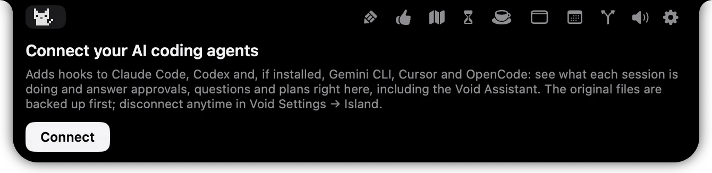
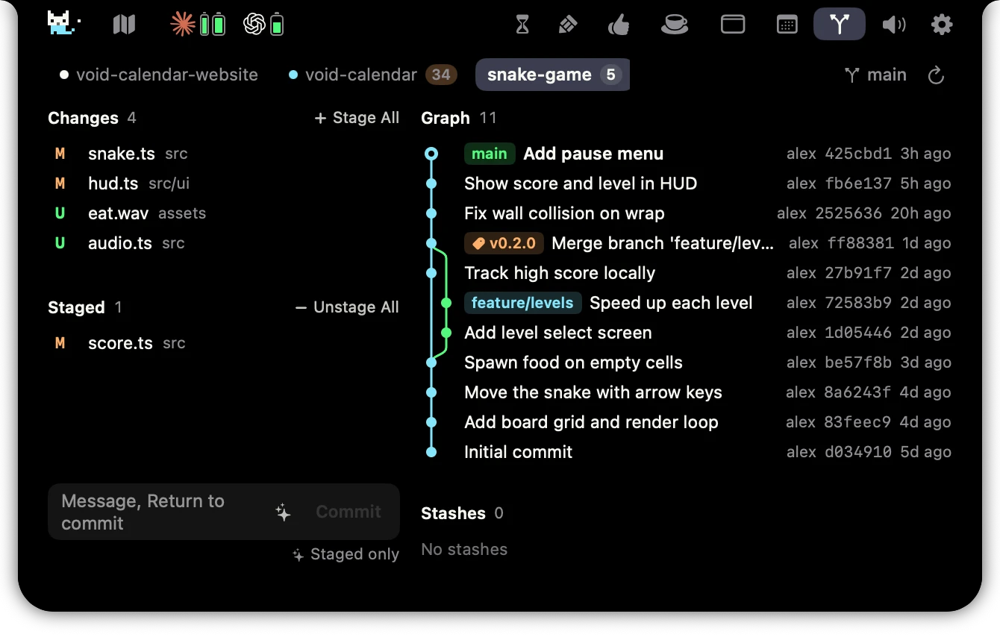

# Void Island

**AI sessions, Git and a little focus, in your Mac’s notch.**

[Product page](https://voido.ai/en/product/island) · [Report a bug](https://github.com/void-vision/void-island/issues/new) · [Request a feature](https://github.com/void-vision/void-island/issues/new) · [简体中文](README.zh-CN.md)

- Follow your AI coding sessions and see when they need attention.
- View approvals and questions, and return to the session’s app.
- Inspect repository changes and commit history.
- Keep your Mac awake while you work.

Void Island has its own settings window. Connecting it to Voido also brings your calendar, notes and focus workflow into the island.

## A look inside

### AI connections

### Git

These images are reused from the existing public product page and may differ from the current app.

## Feedback

Found a bug or have an idea? [Open an issue](https://github.com/void-vision/void-island/issues/new).

For bugs, include your macOS and Void Island versions, the steps to reproduce, and what you expected to happen. A short recording helps; remove private information before sharing it.

This repository contains product information and community feedback. See the [product page](https://voido.ai/en/product/island) for installation information and availability. A standalone installer has not been published in this repository’s releases yet.
