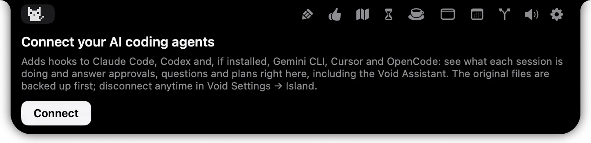
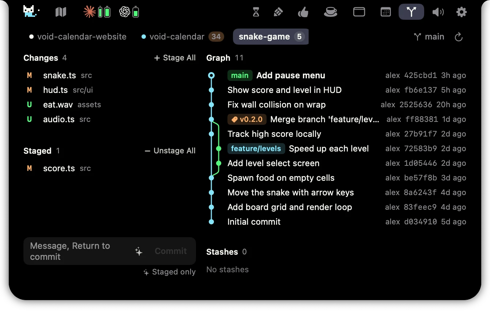

# Void Island

**在 Mac 的刘海里，查看 AI 会话、Git 改动，保持专注。**

[产品介绍](https://voido.ai/product/island) · [反馈问题](https://github.com/void-vision/void-island/issues/new) · [提出建议](https://github.com/void-vision/void-island/issues/new) · [English](README.md)

- 查看 AI 编程会话的状态，知道什么时候需要你处理。
- 查看授权和提问，跳回会话所在的应用。
- 查看 Git 仓库的改动与提交记录。
- 工作时让 Mac 保持唤醒。

Void Island 有独立的设置窗口。连接 Voido 后，还能在岛上使用日程、笔记和专注功能。

## 看看 Void Island

### 连接 AI 助手

### Git 改动与历史

以上图片沿用已有公开产品页的演示图，可能与当前应用界面不同。

## 欢迎反馈

遇到问题，或有想让 Void Island 做得更好的地方，欢迎[提交 issue](https://github.com/void-vision/void-island/issues/new)。

反馈 bug 时，请附上 macOS 和 Void Island 版本、复现步骤、预期结果与实际结果。有短录屏会更容易定位；分享前请去掉私人信息。

本仓库用于产品展示和收集反馈。安装方式与可用性请查看[产品页](https://voido.ai/product/island)。本仓库的 releases 尚未发布独立安装包。
