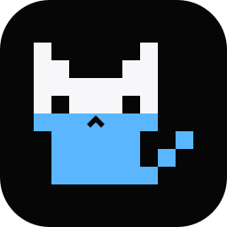
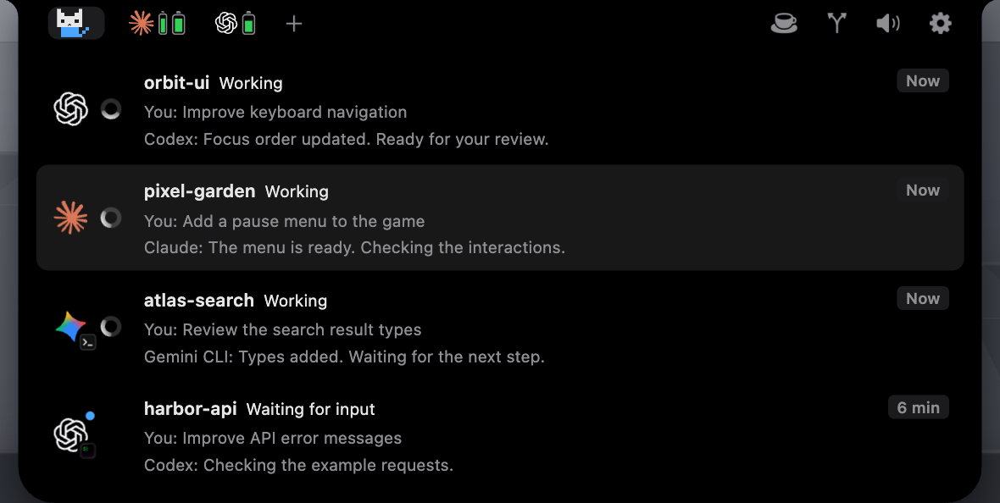
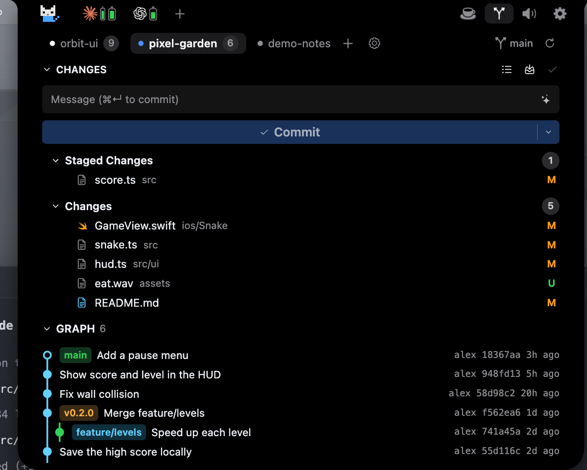
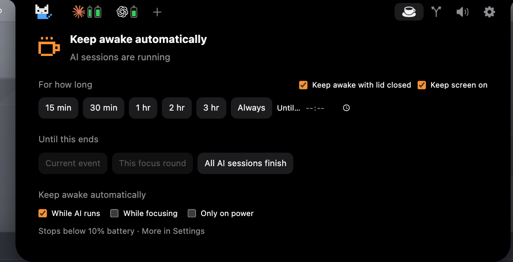

# Void Island

**在 Mac 的刘海里，查看 AI 会话、Git 改动，让电脑保持唤醒。**

[官网](https://voidisland.app/) · [Discord 社区](https://discord.gg/Z3fh88qHwN) · [反馈问题](https://github.com/void-vision/void-island/issues/new) · [提出建议](https://github.com/void-vision/void-island/issues/new) · [English](README.md)

集中查看 AI 编程会话，在需要你时处理授权和提问，回到正确的应用。内置 AI 会话、Git、防休眠三个插件，可以在 Island 自己的设置里分别开关。

## 看看 Void Island

### AI 会话

展示已连接的会话、正在处理和等待输入的状态、授权与提问。图标区分 AI 助手与终端或桌面应用；运行的任务越多，像素猫的蓝色填充越多。

### Git

查看改动和已暂存文件，填写提交说明，浏览默认展开的提交图谱。

### 防休眠

选择保持唤醒的时长、直到 AI 会话结束，或在 AI 运行时自动保持唤醒；屏幕和电源相关选项与时长设置放在一起。

以上截图来自官网互动演示，使用虚构会话和样例仓库，不包含私人账号或项目数据；与安装版本可能存在差异。

## 独立使用与 Voido 联动

Void Island 有独立的设置窗口。AI 会话、Git 和防休眠可以单独使用。连接 [Voido](https://voido.ai/) 后，还能把日程、笔记和专注工作流带进岛里；这些功能需要 Voido。

这里介绍的是内置插件。目前没有将面向所有用户的第三方 Island 插件市场列为已开放功能。

## 下载与发布

独立版本的发布信息请查看 [voidisland.app](https://voidisland.app/)。本仓库的 [Releases](https://github.com/void-vision/void-island/releases) 尚未发布完成验证的独立安装包。

## 欢迎反馈

遇到问题或有想法，欢迎[提交 issue](https://github.com/void-vision/void-island/issues/new) 或[加入 Discord](https://discord.gg/Z3fh88qHwN)。

反馈 bug 时，请附上 macOS 和 Void Island 版本、使用的 AI 助手与终端或桌面应用、复现步骤和预期结果。有短录屏会更容易定位；分享前请去掉私人信息。

本仓库用于产品展示和收集反馈。
